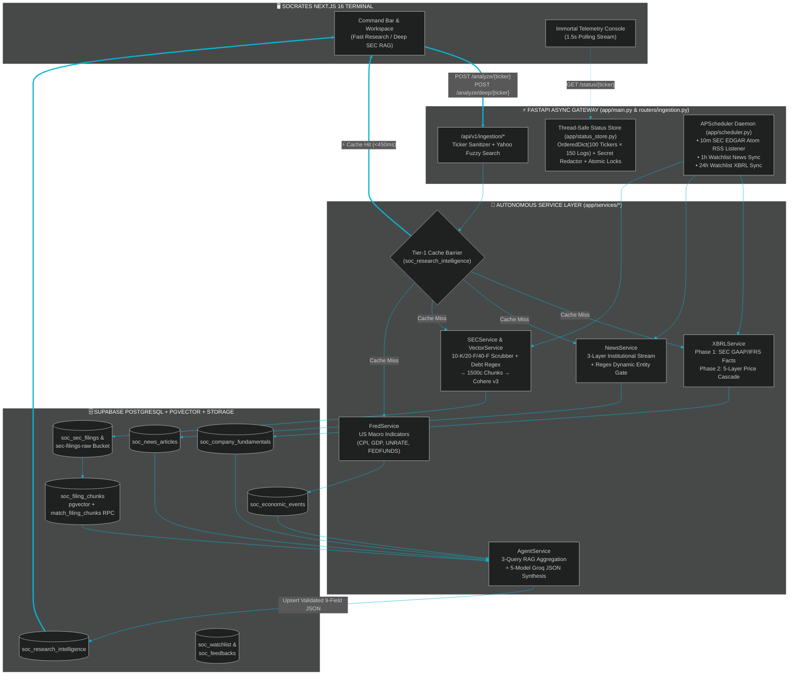
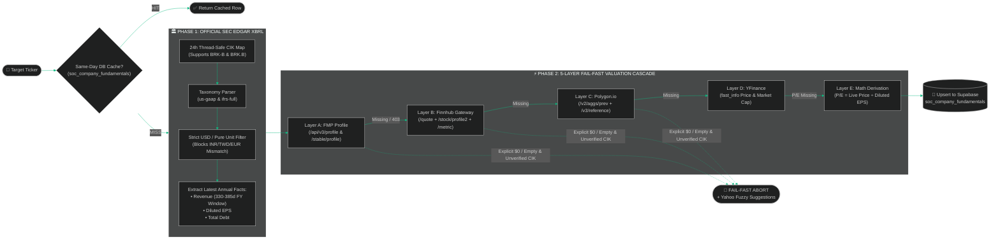
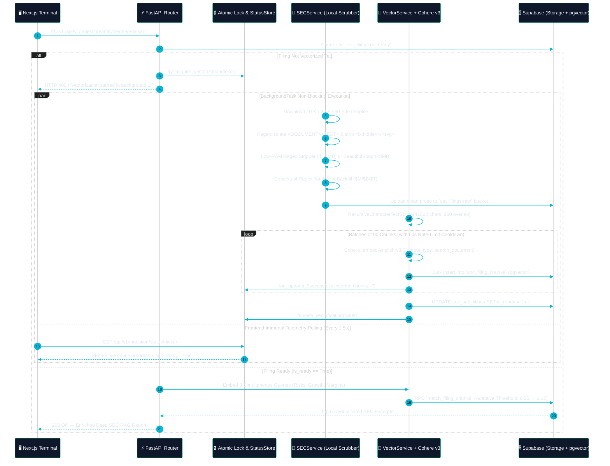
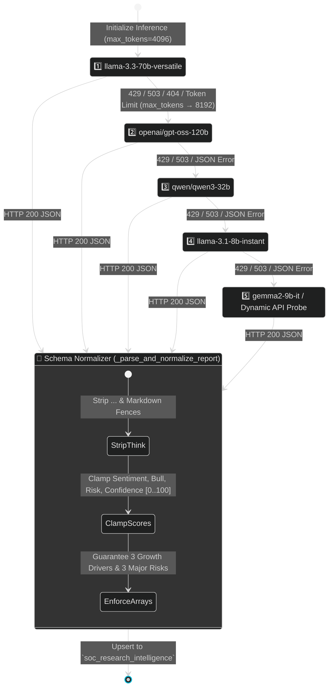
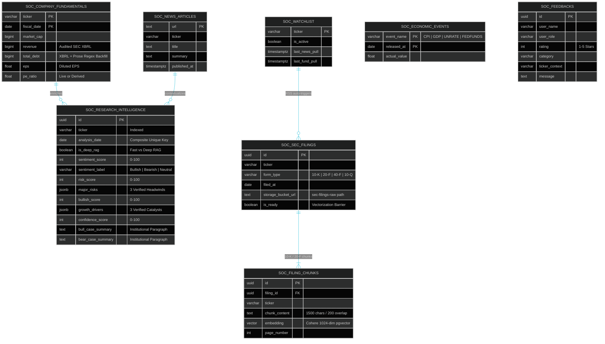

<div align="center">

<!-- ANIMATED HERO WAVE BANNER -->


<!-- ANIMATED TYPING TELEMETRY SVG -->
<a href="https://socrates-frontend.vercel.app">
  
</a>

<br />

<!-- TECH STACK & LIVE STATUS BADGES -->
<p align="center">
  <a href="https://socrates-frontend.vercel.app"></a>
  <a href="https://socrates-backend-kbyq.onrender.com"></a>
  
  
  
  
  
  
</p>

<!-- QUICK NAVIGATION BAR -->
<p align="center">
  <a href="#-executive-telemetry-scorecard"><kbd>📊 Telemetry</kbd></a> •
  <a href="#️-end-to-end-system-architecture"><kbd>🏗️ Architecture</kbd></a> •
  <a href="#-5-layer-valuation--xbrl-cascade"><kbd>💎 5-Layer Cascade</kbd></a> •
  <a href="#-deep-sec-rag--cohere-pgvector-engine"><kbd>🔬 Deep SEC RAG</kbd></a> •
  <a href="#-dynamic-5-model-groq-failover-mesh"><kbd>🤖 LLM Failover</kbd></a> •
  <a href="#️-supabase-postgresql--pgvector-schema"><kbd>🗄️ DB Schema</kbd></a> •
  <a href="#-api-gateway-reference"><kbd>📡 API Matrix</kbd></a>
</p>

</div>

---

## 📊 Executive Telemetry Scorecard

<table>
  <tr>
    <td align="center" width="25%">
      <br />
      <sub><b>Tier-1 PostgreSQL Intercept</b><br />Bypasses LLM & Vector compute on same-day `(ticker, date, mode)` hits</sub>
    </td>
    <td align="center" width="25%">
      <br />
      <sub><b>2-Phase XBRL + 5-Layer Cascade</b><br />SEC EDGAR GAAP/IFRS + FMP → Finnhub → Polygon → YFinance → Math</sub>
    </td>
    <td align="center" width="25%">
      <br />
      <sub><b>OOM-Proof Local iXBRL Scrubber</b><br />Regex stream-stripping for filings &gt;3MB prior to 1500-char chunking</sub>
    </td>
    <td align="center" width="25%">
      <br />
      <sub><b>Self-Healing Groq Router</b><br />Auto-rotates across 5 reasoning models on HTTP 429/503 or token overflow</sub>
    </td>
  </tr>
</table>

---

## 🏗️ End-to-End System Architecture



---

## 💎 5-Layer Valuation & XBRL Cascade

Standard financial wrappers break when cloud IPs are rate-limited or when analyzing foreign ADRs (`20-F` / `40-F`). [`XBRLService`](file:///C:/Users/Amart/Desktop/Projects/socrates_backend/app/services/xbrl_service.py) solves this with a **2-Phase Audited Accounting + 5-Layer Valuation Cascade**:



---

## 🔬 Deep SEC RAG & Cohere `pgvector` Engine

Massive `10-K`, `20-F`, `40-F`, and `10-Q` filings often exceed **15MB–40MB** of raw iXBRL markup, crashing standard cloud instances with `512MB RAM` limits or triggering `HTTP 504` gateway timeouts. [`SECService`](file:///C:/Users/Amart/Desktop/Projects/socrates_backend/app/services/sec_service.py) and [`VectorService`](file:///C:/Users/Amart/Desktop/Projects/socrates_backend/app/services/vector_service.py) execute an asynchronous, memory-bounded pipeline:



---

## 🤖 Dynamic 5-Model Groq Failover Mesh

To guarantee **zero downtime** when LLM providers experience rate limits (`HTTP 429`), capacity spikes (`HTTP 503`), model deprecations (`HTTP 404`), or JSON truncation, [`AgentService`](file:///C:/Users/Amart/Desktop/Projects/socrates_backend/app/services/agent_service.py) implements an autonomous model rotation and schema normalization state machine:



---

## 📰 3-Layer Institutional News & Dynamic Entity Gate

Syndicated financial feeds frequently tag mega-cap tickers (`NVDA`, `AAPL`) or single-letter tickers (`F`, `T`, `C`) in unrelated market roundups. [`NewsService`](file:///C:/Users/Amart/Desktop/Projects/socrates_backend/app/services/news_service.py) enforces a strict **30-minute cache barrier**, a **3-provider cascade**, and a **Regex Dynamic Entity Gate**:

| Layer | Provider | Timeout / Strategy | Dynamic Entity Gate (`_matches_entity_gate`) |
| :--- | :--- | :--- | :--- |
| **Layer 1** | **Alpaca Benzinga SDK** | `ThreadPoolExecutor` (`10.0s` hard timeout, non-blocking shutdown) | 1. Word-boundary regex on `$TICKER` (`(?<![a-z0-9])\$?ticker(?![a-z0-9])`)<br/>2. Strips corporate/ADR suffixes (`Inc.`, `Corp.`, `Class A`, `Sponsored ADR`)<br/>3. If tagged with `&gt;4` symbols, requires entity match **in headline** |
| **Layer 2** | **Finnhub Company News** | `6.0s` REST fallback (`30-day` window) | Filters up to 20 articles through the same compiled entity regex patterns |
| **Layer 3** | **Polygon.io Reference News** | `6.0s` emergency REST gateway | URL deduplication map prior to PostgreSQL `ON CONFLICT (url)` batch upsert |

---

## 🗄️ Supabase PostgreSQL & `pgvector` Schema



---

## 📡 API Gateway Reference (`/api/v1/ingestion`)

| Method | Endpoint | Service Orchestration | Description |
| :---: | :--- | :--- | :--- |
| `POST` | `/analyze/{ticker}` | `XBRL` + `News` + `SEC (Async)` + `Agent` | Executes **Fast Research** (`use_rag=False`) and silently launches background SEC vectorization if missing. |
| `POST` | `/analyze/deep/{ticker}` | `XBRL` + `SEC` + `Vector` + `News` + `Agent` | Executes **Multi-Query Deep SEC RAG** (`use_rag=True`) or auto-repairs/initiates background indexing (`HTTP 400`). |
| `GET` | `/status/{ticker}` | `status_store` + `soc_sec_filings` | Streams bounded live execution logs (`MAX=150`), `is_vectorizing` lock state, and `sec_ready` metadata. |
| `GET` | `/report/{ticker}` | `AgentService` | Instant zero-LLM retrieval of a cached report snapshot with latest fundamentals, news, and SEC status. |
| `GET` | `/history` | `ingestion.py` | Curated **Intelligence Vault** feed supporting `unique_only=true` or `min_days_apart=7` temporal deduplication. |
| `GET` / `POST` | `/macro` | `FredService` | Reads or ingests live Federal Reserve (FRED) US CPI, GDP, Unemployment, and Fed Funds Rate indicators. |
| `GET` | `/search` | `ingestion.py` | Live Yahoo Finance equity autocomplete (`?q=`) for the command bar and fuzzy error recovery. |
| `GET`/`POST`/`DELETE` | `/watchlist/{ticker}` | `ingestion.py` + `APScheduler` | Manages active equities tracked by the autonomous background cron jobs. |
| `GET` / `POST` | `/feedback` | `ingestion.py` | Reads and stores verified 5-star institutional telemetry reviews in `soc_feedbacks`. |

---

## 📂 Repository Blueprint

```text
socrates_backend/
├── app/
│   ├── main.py                      # FastAPI v1.1.0 entry point, CORS regex rules & APScheduler lifespan
│   ├── config.py                    # Pydantic BaseSettings (.env loader for 9 cloud credentials)
│   ├── database.py                  # Singleton Supabase PostgreSQL + Storage client
│   ├── scheduler.py                 # Coalesced BackgroundScheduler (10m SEC RSS, 1h News, 24h XBRL)
│   ├── status_store.py              # Thread-safe LRU log ring buffer + Secret Redactor + Atomic Locks
│   ├── routers/
│   │   └── ingestion.py             # 12 REST endpoints + ticker validation + fuzzy suggestion engine
│   └── services/
│       ├── agent_service.py         # Tier-1 Cache Barrier + 3-Query RAG + 5-Model Groq Failover
│       ├── xbrl_service.py          # SEC EDGAR XBRL parser (US-GAAP/IFRS) + 5-Layer Valuation Cascade
│       ├── sec_service.py           # 10-K/20-F/40-F downloader, OOM-safe HTML scrubber & Debt regex
│       ├── vector_service.py        # LangChain chunker (1500/200) + Cohere v3 batch embedder -> pgvector
│       ├── sec_listener_service.py  # Live SEC EDGAR Atom RSS scanner matching watchlist CIKs
│       ├── news_service.py          # Alpaca Benzinga -> Finnhub -> Polygon cascade + Entity Gate
│       └── fred_service.py          # St. Louis Fed (FRED) macroeconomic telemetry collector
└── requirements.txt                 # Pinned production dependencies
```

---

## 🚀 Quick Start & Environment Setup

### 1. Configure `.env` Credentials
Create a `.env` file in the root of `socrates_backend`:

```ini
# Required Core Infrastructure
SUPABASE_URL="https://your-project.supabase.co"
SUPABASE_KEY="your-supabase-service-or-anon-key"
GROQ_API_KEY="gsk_..."
COHERE_API_KEY="your-cohere-v3-key"

# Institutional Market, News & Macro Gateways
FRED_API_KEY="your-st-louis-fed-key"
ALPACA_API_KEY="PK..."
ALPACA_SECRET="your-alpaca-secret"
FMP_API_KEY="your-fmp-key"
FINNHUB_API_KEY="your-finnhub-key"
POLYGON_API_KEY="your-polygon-key"
```

### 2. Install & Launch the Engine

```bash
# Install pinned dependencies
pip install -r requirements.txt

# Launch the FastAPI Uvicorn server with hot-reload
uvicorn app.main:app --reload --port 8000
```

---

<div align="center">

### 👨‍💻 System Architect

**Amartya Sen**  
*B.Tech in Computer Science & Engineering (Artificial Intelligence & Machine Learning)*  
Architecting fault-tolerant, autonomous AI systems at the intersection of quantitative finance and deep learning.

<p align="center">
  <a href="https://www.linkedin.com/in/amartya-sen"></a>
  <a href="https://github.com/AmartyaSen23"></a>
  <a href="https://socrates-frontend.vercel.app"></a>
</p>


</div>
